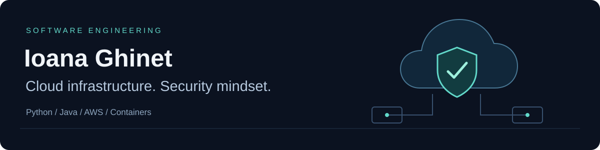

  <a href="https://linkedin.com/in/ioanateodoraghinet">LinkedIn</a> &nbsp;·&nbsp;
  <a href="mailto:ioanaghinet@yahoo.com">Email</a> &nbsp;·&nbsp;
  <a href="https://github.com/ioanaghi?tab=repositories">Explore my work</a>

## Building toward secure cloud systems

I'm Ioana, a software engineer focused on **cloud infrastructure, security, and dependable delivery**. I work across Python and Java, with an interest in how applications are deployed, how data moves between components, and where trust boundaries belong.

My background includes computer science at the **Technical University of Cluj-Napoca** and working-student experience at **NTT DATA**, spanning Java, Spring Boot, containerized workloads, and CI/CD pipeline security.

**Project highlight:** I co-founded **Safernav**, an AWS-deployed threat-classification system combining Isolation Forests and neural models. Our team won **1st place in the Cybersecurity Track at Polihack v17**.

## Engineering focus

- **Cloud & delivery:** AWS, Docker, Kubernetes, and CI/CD workflows.
- **Security & data:** network-traffic analysis, threat classification, and reproducible ML experiments.
- **Software foundations:** Java/Spring Boot, Python, PostgreSQL, modular design, and explicit system boundaries.

## Selected public work

These projects show the implementation behind my interests, from security experiments to application delivery and systems fundamentals.

### Security & machine learning

**[Network Traffic Anomaly Detection](https://github.com/ioanaghi/Anomaly-Detection)** 
PCAP processing and classification experiments with scikit-learn, PyTorch, and TensorFlow. An experimental foundation for security tooling, with evaluation limitations documented openly.

### Systems & software architecture

**[Translators Design](https://github.com/ioanaghi/Translators_Design_Laboratories)** 
Flex scanners, recursive-descent parsers, ASTs, stack-machine code generation, and introductory LLVM IR in C/C++.

**[Task Management](https://github.com/ioanaghi/TaskManagementApplication)** 
A JavaFX desktop application exploring MVC, nested task models, workload tracking, and local persistence.

### Applications & delivery

**[IRIS Curățenie](https://github.com/ioanaghi/Iris-Curatenie-Web)** · [Live website](https://iris-eight-drab.vercel.app) 
A responsive business website built with Next.js, TypeScript, and Tailwind CSS, deployed on Vercel.

**[ElectriGo](https://github.com/ioanaghi/ElectriGo-App)** 
React Native/Expo EV-charging discovery prototype with maps and vehicle-management flows. **Innovation Labs semifinalist project.**

**[Timy](https://github.com/ioanaghi/Timy-App)** 
A Flutter/FlutterFlow app designed to support autistic users. **Third place at Polihack.**

---

I’m interested in the engineering that connects **application code, infrastructure, and security**: clear configuration, reproducible environments, controlled access, and observable systems.
